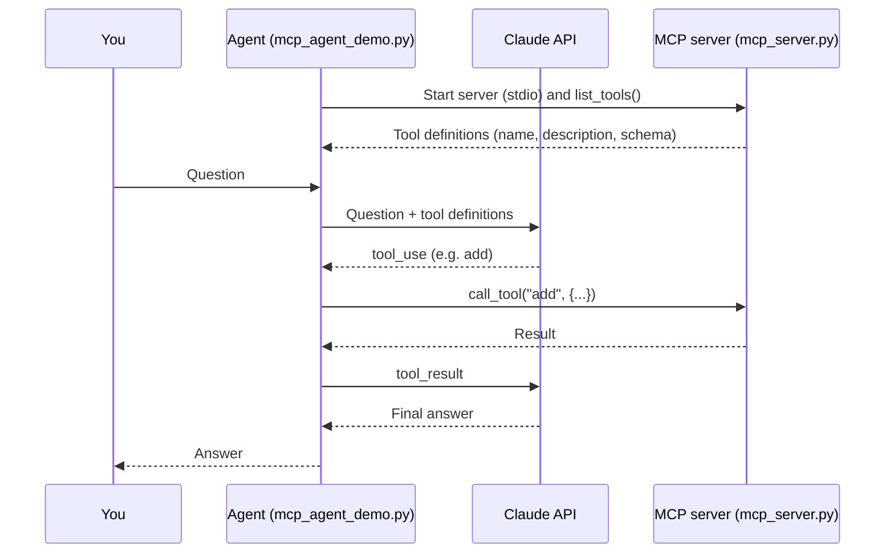

# MCP Agent Demo


A small, self-contained demo of an **AI agent that uses tools from an MCP server**.
The agent connects to a local [Model Context Protocol](https://modelcontextprotocol.io) (MCP)
server, discovers its tools automatically and lets Claude decide when to call them,
all in a compact, well-documented Python script.

## Table of Contents

- [Features](#features)
- [How it works](#how-it-works)
- [Project structure](#project-structure)
- [Getting started](#getting-started)
- [Configuration](#configuration)
- [Usage](#usage)
- [Available tools](#available-tools)
- [Adding your own tool](#adding-your-own-tool)
- [Code overview](#code-overview)
- [Troubleshooting](#troubleshooting)
- [Security](#security)
- [Ideas for next steps](#ideas-for-next-steps)

## Features

- **Real MCP integration.** The agent starts an MCP server over `stdio` and talks to it
  with the official MCP Python SDK (`mcp>=2`).
- **Automatic tool discovery.** Tools are listed from the server at startup and converted
  to the Claude tool format. Adding a tool to the server is enough, no agent changes needed.
- **Agent loop.** Claude can call several tools in a row. The loop runs until Claude
  gives its final answer (with a safety limit of 10 steps).
- **Helpful error handling.** Clear messages for invalid keys (401), bad requests (400),
  unknown workspaces or models (404) and connection problems.
- **Safe secret handling.** The API key is read from a local `.env` file that is excluded
  from Git.

## How it works



1. The agent launches `mcp_server.py` as a subprocess and connects to it via `stdio`.
2. It asks the server which tools exist and converts them to the format the Claude API expects.
3. For every question, the agent sends the question and the tool definitions to Claude.
4. If Claude answers with a `tool_use` request, the agent runs that tool on the MCP server
   and sends the result back to Claude.
5. Steps 3 and 4 repeat until Claude replies with plain text. That is the final answer.

## Project structure

```
MCP-Project/
├── mcp_agent_demo.py   # The agent: MCP client + Claude API + agent loop
├── mcp_server.py       # The MCP server with three example tools
├── requirements.txt    # Python dependencies
├── .env.example        # Template for your local .env file
├── .gitignore          # Keeps .env, .venv and caches out of Git
└── README.md
```

## Getting started

### Prerequisites

- Python **3.10 or newer**
- An Anthropic API key from the [Claude Console](https://platform.claude.com/settings/keys)
  (API usage requires credits on your Console account)

### Installation

```bash
# 1. Clone the repository
git clone https://github.com/<your-username>/<your-repo>.git
cd <your-repo>

# 2. Create and activate a virtual environment
python -m venv .venv
source .venv/Scripts/activate     # Git Bash on Windows
# .venv\Scripts\Activate.ps1      # PowerShell on Windows
# source .venv/bin/activate       # macOS / Linux

# 3. Install dependencies
pip install -r requirements.txt

# 4. Create your .env file
cp .env.example .env
```

Open `.env` in an editor and paste your API key (see [Configuration](#configuration)).

## Configuration

All settings are read from the `.env` file in the project folder.

| Variable | Required | Description |
| --- | --- | --- |
| `ANTHROPIC_API_KEY` | Yes | Your API key. The Console shows the full key **only once**, directly after creating it. |
| `ANTHROPIC_WORKSPACE_ID` | Only for keys that are not tied to a workspace | Workspace ID (`wrkspc_...`), found in the Console under *Settings → Workspaces*. |

Example `.env`:

```
ANTHROPIC_API_KEY=your_key_here
# ANTHROPIC_WORKSPACE_ID=wrkspc_...
```

The model and limits are constants at the top of `mcp_agent_demo.py`:

| Constant | Default | Meaning |
| --- | --- | --- |
| `MODEL` | `claude-sonnet-5-5` | Claude model used for the agent |
| `MAX_TOKENS` | `1000` | Maximum length of each response |
| `MAX_STEPS` | `10` | Maximum number of tool-call rounds per question |

## Usage

```bash
python mcp_agent_demo.py
```

The agent starts the MCP server by itself, you do not need to run `mcp_server.py` manually.
Type a question, and type `exit` to quit.

Example session:

```
Connected to MCP server. Tools: add, word_count, get_current_time
Model: claude-sonnet-5-5. Type 'exit' to quit.

You: What is 17.5 + 24.25?
  -> Tool: add({'a': 17.5, 'b': 24.25})

Claude: 17.5 + 24.25 = **41.75**
```

The line starting with `->` shows that Claude called the `add` tool on the MCP server.
If a question needs no tool, or no suitable tool exists (for example a weather question),
Claude simply answers on its own and says so.

> Note: each question is handled independently. The agent does not remember earlier questions yet.

## Available tools

| Tool | Arguments | Description |
| --- | --- | --- |
| `add` | `a: float`, `b: float` | Adds two numbers |
| `word_count` | `text: str` | Counts the words in a text |
| `get_current_time` | none | Returns the current date and time with time zone offset |

## Adding your own tool

Open `mcp_server.py` and add a function with the `@mcp.tool()` decorator. The function name
becomes the tool name, the docstring becomes the description Claude sees, and the type hints
become the input schema.

```python
@mcp.tool()
def multiply(a: float, b: float) -> float:
    """Multiplies two numbers."""
    return a * b
```

Restart the agent. It lists the server's tools at startup, so the new tool is available
immediately. Clear docstrings matter: Claude uses them to decide when to call a tool.

## Code overview

| Function | File | Purpose |
| --- | --- | --- |
| `create_client()` | `mcp_agent_demo.py` | Builds the async Claude client from `.env`, optionally with a workspace header |
| `to_anthropic_tools()` | `mcp_agent_demo.py` | Converts MCP tool descriptions to the Claude tool format |
| `run_tool()` | `mcp_agent_demo.py` | Calls a tool on the MCP server and returns its text result and error flag |
| `ask()` | `mcp_agent_demo.py` | The agent loop: ask Claude, run requested tools, repeat until done |
| `main()` | `mcp_agent_demo.py` | Starts the server, connects, and runs the interactive prompt |

## Troubleshooting

| Problem | Likely cause and fix |
| --- | --- |
| `401 invalid x-api-key` | The key is incomplete, expired or from the wrong organization. Create a new key in the Console and copy it right after creating it. Check that the variable has the full key: `echo ${#ANTHROPIC_API_KEY}` should not print a very short number. |
| The key in `.env` seems to be ignored | An older value may be set as a Windows environment variable. The script uses `load_dotenv(override=True)`, so `.env` wins. Check that the file is really named `.env` (not `.env.txt`) with `ls -a`. |
| `400` mentioning `anthropic-workspace-id` | Your key is not tied to a workspace. Set `ANTHROPIC_WORKSPACE_ID` in `.env`. |
| `404` workspace or model not found | Check the workspace ID and the `MODEL` constant. |
| `ModuleNotFoundError: mcp.server.mcpserver` | You have MCP SDK 1.x installed. Run `pip install -U "mcp>=2"`. |
| `SyntaxError` near `async with (` | Your Python is older than 3.10. Upgrade Python. |

## Security

- **Never commit your `.env` file.** It is listed in `.gitignore`. Only `.env.example`
  (without a real key) belongs in the repository.
- If a key was ever committed or shared, delete it in the Claude Console and create a new one.
- The example tools are harmless. If you add tools that read files or call external services,
  think about what Claude should be allowed to do with them.

## Ideas for next steps

- Add a weather tool (for example with the free Open-Meteo API) so Claude can answer weather questions
- Keep the conversation history between questions
- Connect the agent to existing MCP servers (files, databases, GitHub)
- Stream Claude's answers token by token
- Add automated tests for the tools